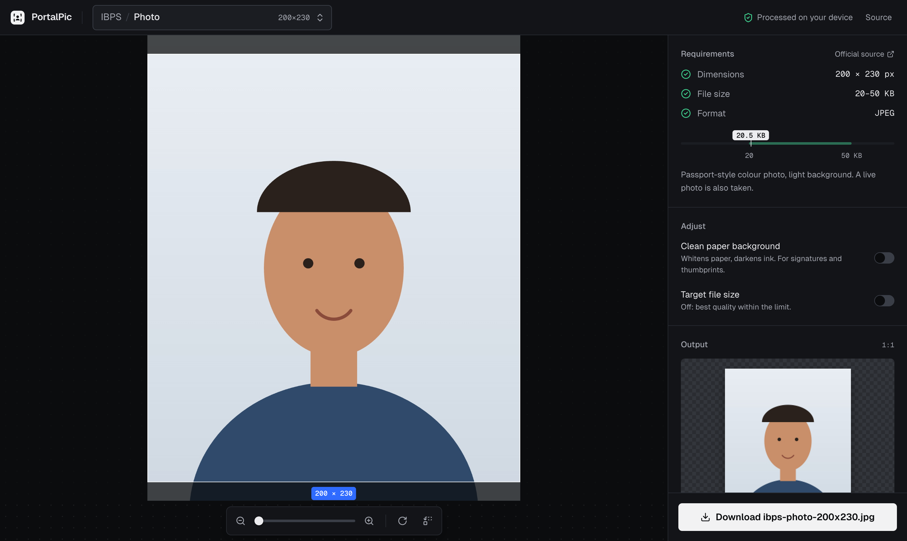

# PortalPic

**Resize photos and signatures to the exact pixel size and KB limit that exam, visa and passport portals ask for. Free, and it runs entirely in your browser: your photo never leaves your device.**

**→ [portalpic.com](https://portalpic.com)**



## Why

Application portals reject uploads that are a few KB or pixels off, with errors like "file size must be between 20 KB and 50 KB". So people end up uploading their passport photos and signatures to ad-filled resizer sites ([example](https://reddit.com/comments/1xnhggs)). PortalPic does the job on your own device, with presets checked against each portal's official notice.

## How to use it

1. Open [portalpic.com](https://portalpic.com) and pick your form, e.g. *IBPS / Photo* or *US Visa / DS-160 photo*. Each form also has its own link, like [portalpic.com/ibps-photo](https://portalpic.com/ibps-photo).
2. Drop, choose or paste a photo or a scanned signature.
3. Drag and zoom to frame it. The checklist turns green when the size, file size and format all pass.
4. Click **Download** and upload the file to the portal.

## Features

- **34 presets** ([full list](#presets)): Indian exams (IBPS, SSC, UPSC, RRB, NEET, JEE Main, CUET, GATE), PAN, Indian e-Visa, visa and OCI, and visa or passport photos for the US, UK, Canada, Australia, China, Singapore, Ireland and New Zealand. Plus a custom size.
- **PDF tool** ([portalpic.com/pdf](https://portalpic.com/pdf)): merge PDFs and photos into one PDF, in any order, under a size limit (100 KB to 5 MB, or any value). It keeps the output a real PDF: original pages when they fit, otherwise the same pages with only the pictures inside recompressed, so text, links and highlights survive. Only if that still can't fit does it redraw each page as an image, and it says so. A locked or damaged file in the mix is redrawn on its own; the other files keep their text. *Rebuild every page* produces a plain new PDF for portals that reject a file as invalid, corrupted, signed or locked. Password-locked PDFs open with the password, which stays in the tab. Uses [pdf.js](https://mozilla.github.io/pdf.js/) and [pdf-lib](https://pdf-lib.js.org), loaded only on that page.
- **Hits the KB range exactly.** It searches for the highest JPEG quality that fits under the maximum. If even full quality is under the minimum, it pads the file with invisible JPEG comment bytes; the pixels are unchanged.
- **Exam kits:** pick any upload of an exam and tabs show everything that exam needs (e.g. IBPS: photo, signature, thumb, declaration), with a tick on each one you've downloaded.
- **Face guide:** a dashed head outline over photo presets, sized from the official rule where one exists (NEET/JEE/CUET 80%, UPSC 78%, Canada 45–50%).
- **Works offline and installs like an app:** after one visit it keeps working without internet; Chrome and Android show an **Install** button.
- **Optional target size** inside the allowed range, for portals that are picky in practice.
- **Crop, zoom and rotate** locked to the required shape, plus a *clean paper* filter that whitens the background and darkens ink on signatures and thumb impressions.
- **Sets DPI** in the file header where a portal asks for it (IBPS thumb and declaration, PAN, RRB).
- **Strips metadata**, including GPS location, because only the pixels are copied.
- **Won't crash on huge files:** it reads the image size from the file header and refuses anything over 64 megapixels or 60 MB before opening it.
- **Works on cheap phones** and keeps working offline once the page has loaded.

## Privacy

- Photos and PDFs are cropped, merged and compressed by your browser. There is no server that receives files, and nothing is saved: closing the tab clears everything except the last form and PDF size limit you picked.
- The only network traffic is cookieless, anonymous counts from [Vercel Web Analytics](https://vercel.com/docs/analytics): page visits, and each download counted as a visit to `/_download/<preset>`. Never the file, its size, its name or anything you type.
- The [Content Security Policy](vercel.json) sets `connect-src 'self'`, so the page cannot contact any other website.
- You can check it yourself: load the page, turn on airplane mode, and everything still works.

## How it works

1. **Open safely.** `loadImage` reads the width and height from the file header (PNG, JPEG, GIF, BMP, WebP) and rejects decompression bombs before decoding. The image is then decoded with the right orientation and scaled to at most 4096 px on the long side.
2. **Frame.** [react-easy-crop](https://github.com/ValentinH/react-easy-crop) provides the crop box and reports the chosen rectangle.
3. **Draw.** That rectangle is drawn onto a white canvas at the exact output size, with optional ink cleanup.
4. **Compress.** The browser's JPEG encoder (`canvas.toBlob`) is run in a binary search over quality, about 8 tries, to find the best quality inside the KB limit. KB limits use the strict reading on both ends (max × 1000 bytes, min × 1024 bytes), because portals disagree on which they mean.
5. **Finish.** Padding up to the minimum if needed, DPI written into the JFIF header, then a download link created in memory.

## Presets

Each upload links to its own page on the site. `*` means the portal gives a range or only a KB limit, so the size shown is one we picked that satisfies the rules.

| Portal | Upload | Pixels | File size | DPI | Source |
|---|---|---|---|---|---|
| IBPS | [Photo](https://portalpic.com/ibps-photo) | 200 × 230 | 20 KB–50 KB |  | [official](https://www.ibps.in/wp-content/uploads/Detailed-Notification_CRP-PO-XV.pdf) |
| IBPS | [Signature](https://portalpic.com/ibps-signature) | 140 × 60 | 10 KB–20 KB |  | [official](https://www.ibps.in/wp-content/uploads/Detailed-Notification_CRP-PO-XV.pdf) |
| IBPS | [Left thumb impression](https://portalpic.com/ibps-thumb) | 240 × 240 | 20 KB–50 KB | 200 | [official](https://www.ibps.in/wp-content/uploads/Detailed-Notification_CRP-PO-XV.pdf) |
| IBPS | [Handwritten declaration](https://portalpic.com/ibps-declaration) | 800 × 400 | 50 KB–100 KB | 200 | [official](https://www.ibps.in/wp-content/uploads/Detailed-Notification_CRP-PO-XV.pdf) |
| SSC | [Signature](https://portalpic.com/ssc-signature) | 360 × 120* | 10 KB–20 KB |  | [official](https://ssc.gov.in/api/attachment/uploads/masterData/NoticeBoards/Notice_of_adv_cgl_2026.pdf) |
| UPSC | [Photo](https://portalpic.com/upsc-photo) | 350 × 450* | 20 KB–200 KB |  | [official](https://upsconline.nic.in/ngrp/assets/PDF/instruction-photo-signature-upload-upsc.pdf) |
| UPSC | [Signature (3 times)](https://portalpic.com/upsc-signature) | 350 × 500* | 20 KB–100 KB |  | [official](https://upsconline.nic.in/ngrp/assets/PDF/instruction-photo-signature-upload-upsc.pdf) |
| RRB (Railways) | [Signature](https://portalpic.com/rrb-signature) | 280 × 120* | 30 KB–49 KB | 200 | [official](https://www.rrbapply.gov.in/assets/forms/CEN_06_2026_NTPC_G.pdf) |
| NEET UG | [Photo](https://portalpic.com/neet-photo) | 350 × 450* | 10 KB–200 KB |  | [official](https://cdnbbsr.s3waas.gov.in/s37bc1ec1d9c3426357e69acd5bf320061/uploads/2026/02/202602231394640855.pdf) |
| NEET UG | [Signature](https://portalpic.com/neet-signature) | 350 × 150* | 10 KB–100 KB |  | [official](https://cdnbbsr.s3waas.gov.in/s37bc1ec1d9c3426357e69acd5bf320061/uploads/2026/02/202602231394640855.pdf) |
| JEE Main | [Photo](https://portalpic.com/jee-photo) | 350 × 450* | 10 KB–200 KB |  | [official](https://cdnbbsr.s3waas.gov.in/s3f8e59f4b2fe7c5705bf878bbd494ccdf/uploads/2026/10/202610241890224107.pdf) |
| JEE Main | [Signature](https://portalpic.com/jee-signature) | 350 × 150* | 10 KB–100 KB |  | [official](https://cdnbbsr.s3waas.gov.in/s3f8e59f4b2fe7c5705bf878bbd494ccdf/uploads/2026/10/202610241890224107.pdf) |
| CUET UG | [Photo](https://portalpic.com/cuet-photo) | 350 × 450* | 10 KB–200 KB |  | [official](https://cdnbbsr.s3waas.gov.in/s3d1a21da7bca4abff8b0b61b87597de73/uploads/2026/01/202601031633478370.pdf) |
| CUET UG | [Signature](https://portalpic.com/cuet-signature) | 350 × 150* | 10 KB–50 KB |  | [official](https://cdnbbsr.s3waas.gov.in/s3d1a21da7bca4abff8b0b61b87597de73/uploads/2026/01/202601031633478370.pdf) |
| GATE | [Photo](https://portalpic.com/gate-photo) | 480 × 640* | 5 KB–600 KB |  | [official](https://gate2026.iitg.ac.in/photograph-and-signature.html) |
| GATE | [Signature](https://portalpic.com/gate-signature) | 480 × 150* | 3 KB–300 KB |  | [official](https://gate2026.iitg.ac.in/photograph-and-signature.html) |
| PAN (Protean/NSDL) | [Photo](https://portalpic.com/pan-nsdl-photo) | 197 × 276* | under 20 KB | 200 | [official](https://tin.tin.nsdl.com/pan/InstructionDSC.html) |
| PAN (Protean/NSDL) | [Signature](https://portalpic.com/pan-nsdl-signature) | 354 × 157* | under 10 KB | 200 | [official](https://tin.tin.nsdl.com/pan/InstructionDSC.html) |
| PAN (UTIITSL) | [Photo](https://portalpic.com/pan-uti-photo) | 213 × 213 | under 30 KB | 300 | [unofficial](https://www.pan.utiitsl.com/) |
| US Visa | [DS-160 photo](https://portalpic.com/us-ds160) | 600 × 600* | 53 KB–240 KB |  | [official](https://travel.state.gov/content/travel/en/us-visas/visa-information-resources/photos/digital-image-requirements.html) |
| US Passport | [Online renewal photo](https://portalpic.com/us-passport-online) | 1200 × 1200* | 54 KB–10 MB |  | [official](https://travel.state.gov/en/passports/renew-replace/online/upload-digital-photo.html) |
| United Kingdom | [Visa photo (online)](https://portalpic.com/uk-visa-online) | 600 × 750* | 50 KB–6 MB |  | [official](https://www.gov.uk/guidance/how-to-take-a-photo-for-a-visa-application-or-permission) |
| United Kingdom | [Passport photo (online)](https://portalpic.com/uk-passport-online) | 600 × 750* | 50 KB–10 MB |  | [official](https://www.gov.uk/photos-for-passports) |
| India Visa & OCI | [e-Visa photo](https://portalpic.com/in-evisa) | 600 × 600* | 10 KB–1 MB |  | [official](https://indianvisaonline.gov.in/evisa/tvoa.html) |
| India Visa & OCI | [Regular visa photo](https://portalpic.com/in-visa-regular) | 600 × 600* | 10 KB–300 KB |  | [official](https://indianvisaonline.gov.in/visa/VSS_IMAGE.pdf) |
| India Visa & OCI | [OCI card photo](https://portalpic.com/in-oci-online) | 600 × 600* | under 200 KB |  | [official](https://www.eoiasuncion.gov.in/how-to-apply-oci.php) |
| Canada | [Passport photo (online)](https://portalpic.com/ca-passport-online) | 1200 × 1800* | 200 KB–5 MB |  | [official](https://www.canada.ca/en/immigration-refugees-citizenship/services/canadian-passports/photos.html) |
| Canada | [PR card photo](https://portalpic.com/ca-pr-card) | 715 × 1000* | under 4 MB |  | [official](https://www.canada.ca/en/immigration-refugees-citizenship/services/new-immigrants/pr-card/apply-renew-replace/photo.html) |
| Canada | [Citizenship photo (online)](https://portalpic.com/ca-citizenship-online) | 420 × 540* | under 4 MB |  | [official](https://www.canada.ca/en/immigration-refugees-citizenship/services/application/application-forms-guides/citizenship-application-photograph-specifications/grant-online.html) |
| Australia | [Citizenship photo (online)](https://portalpic.com/au-citizenship-online) | 1200 × 1600* | 70 KB–3.5 MB |  | [official](https://immi.homeaffairs.gov.au/citizenship/photo-requirements-for-citizenship-applications) |
| China | [Visa photo (COVA online form)](https://portalpic.com/cn-cova) | 354 × 472* | 40 KB–120 KB |  | [official](https://www.visaforchina.cn/MAN4_EN/qianzhengyewu/jichuzhishi/changjianwenti/552365353674608655.html) |
| Singapore | [ICA e-Services photo](https://portalpic.com/sg-ica-eservices) | 400 × 514 | under 8 MB |  | [official](https://www.ica.gov.sg/photo-guidelines) |
| Ireland | [Passport photo (online)](https://portalpic.com/ie-passport-online) | 715 × 951* | under 9 MB |  | [official](https://www.ireland.ie/en/dfa/passports/photo-guidelines/) |
| New Zealand | [Passport photo (online)](https://portalpic.com/nz-passport-online) | 900 × 1200* | 250 KB–5 MB |  | [official](https://www.passports.govt.nz/passport-photos/check-your-photo-meets-the-technical-requirements) |

SSC and RRB photos are taken live by webcam, so those portals only have signature presets.

**Portals change their rules.** Always check the official notification before you upload. To request a new preset or report a wrong one, use the [request form](https://forms.gle/gWTPthBeRC2ScrZy9) (no account needed) or [open an issue](https://github.com/Rishikhesh/portalpic/issues/new?template=preset-request.yml), with a link to the official notice.

## Develop

Vite, React 19, TypeScript (strict), Tailwind CSS v4 and shadcn/ui. Package manager: [bun](https://bun.sh).

```sh
bun install      # installs dependencies and turns on the pre-commit hook
bun run dev      # http://localhost:5173
bun run check    # types, lint, tests and build
```

| Path | What's there |
|---|---|
| `src/lib/presets.ts` | Every preset, with its official source |
| `src/lib/compress.ts` | Quality search, KB rules, JPEG padding, DPI |
| `src/lib/limits.ts` | Header sniffing and the size limits |
| `src/lib/process.ts` | Loading, rotating, drawing and compressing |
| `src/lib/seo.ts`, `scripts/prerender.ts` | Page titles and descriptions; one static page per preset plus `sitemap.xml` |
| `src/components/` | The UI |

### Adding a preset

1. Add an entry to [`src/lib/presets.ts`](src/lib/presets.ts), with `source` pointing to the official notification. Set `exact: true` only when the portal states the pixels.
2. Run `bun run check`. A test fails if an entry has no source, a duplicate id or an impossible size range.
3. Open a pull request. The new form gets its own page and sitemap entry automatically.

### Quality checks

`bun run check` runs before every commit (git hook in `.githooks/`) and as the Vercel build command, so nothing that fails types, lint, tests or the build can go live. Notes for AI coding agents are in [`AGENTS.md`](AGENTS.md).

## Deploy

Hosted on [Vercel](https://vercel.com) at [portalpic.com](https://portalpic.com). Every push to `main` runs the checks and deploys. Security headers live in [`vercel.json`](vercel.json).

## License

[MIT](LICENSE)
